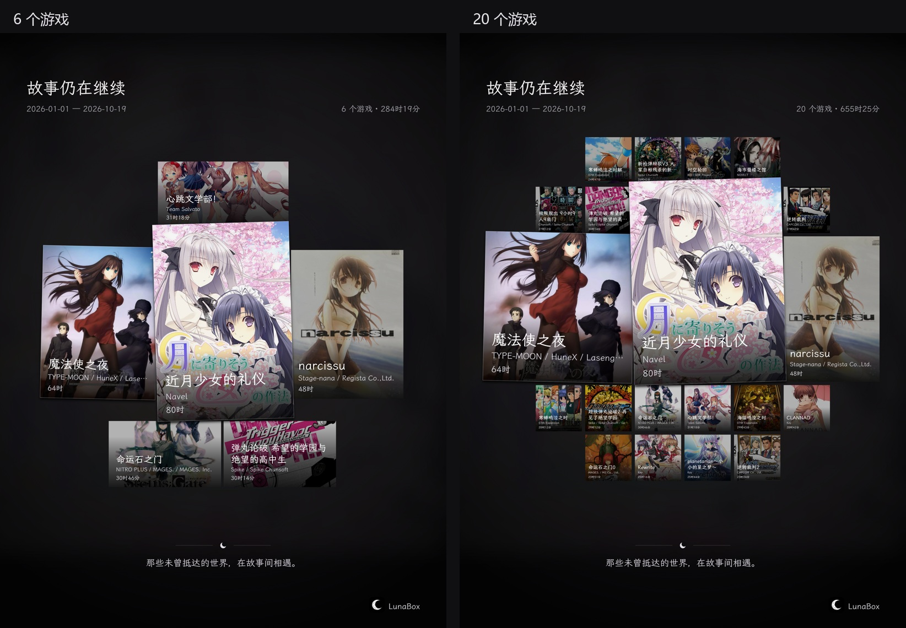
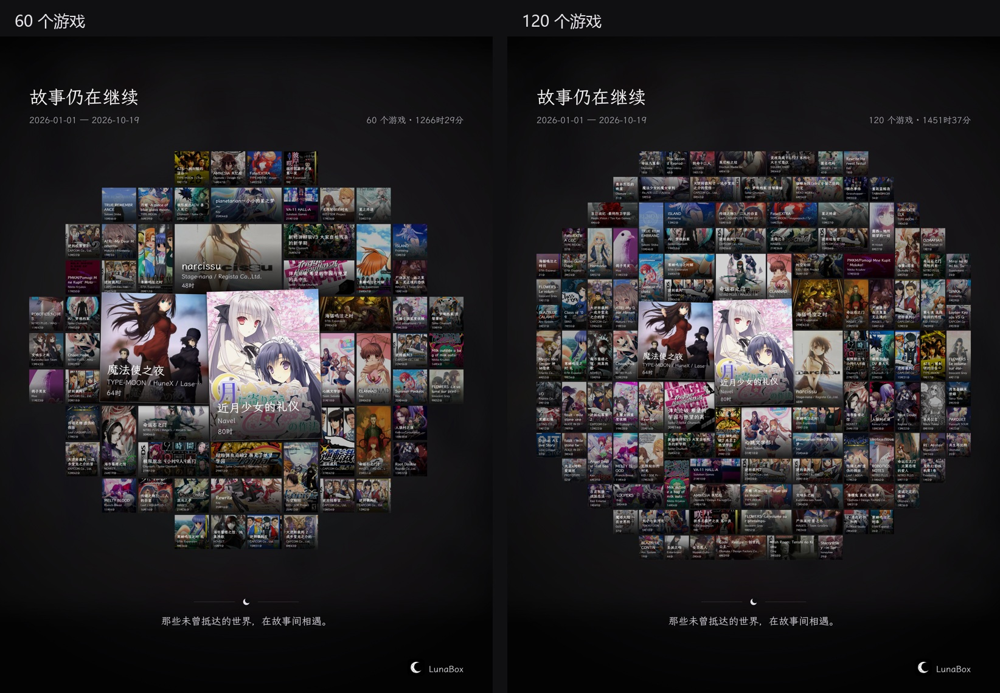
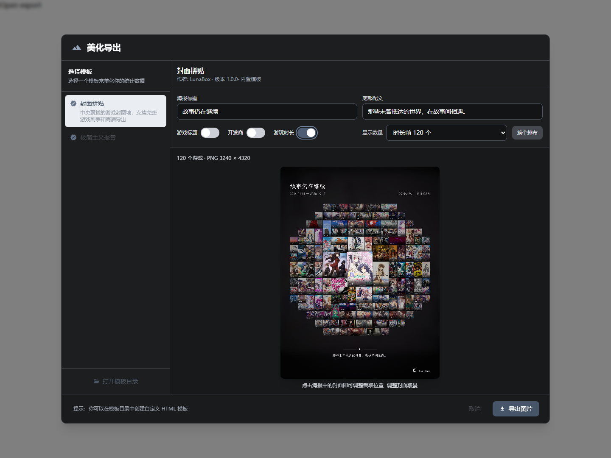
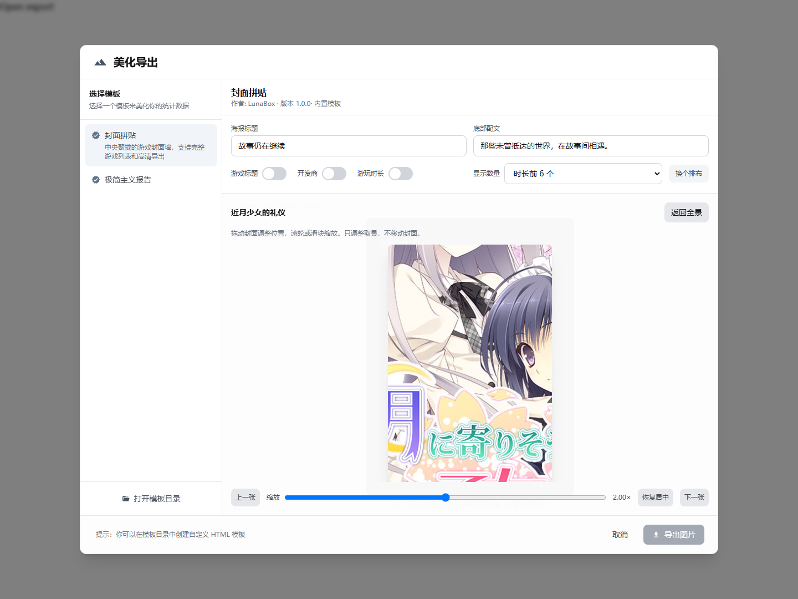

# 封面拼贴海报

统计页 → 美化导出 → **封面拼贴**。

- 使用当前统计日期范围内的完整游戏列表，独立于原排行榜的前 20 名限制。
- 支持全部游戏与时长前 6 / 20 / 60 / 120 个游戏；全部模式不会截断更多的游戏。
- 标题、开发商和每款游戏的期间累计游玩时长分别控制显示。隐藏的是额外叠加文字，封面图片原有文字保留。
- 点击海报中的封面，或使用“调整封面取景”按钮，进入取景编辑。支持拖动、滚轮及 1–3 倍缩放、上一张 / 下一张、恢复居中、Esc 返回全景。裁切按游戏 ID 保存于本次导出草稿，改变数量或排布时保留。
- 取景编辑时只重绘单张封面；返回全景后生成完整图片，随后可导出。
- 导出 PNG 为 **3240 × 4320**，直接保存预览画布，不使用截图放大、在线字体、CDN 或 AI。
- 全部附加文字统一使用随应用打包的霞鹜文楷；右下角使用项目自带的 `appicon-dark.png`。
- 缺失的封面保留占位与游戏数量，并显示可重试提示；空日期范围不允许导出。

布局参考 Lunar 的统计海报（AGPL-3.0），布局、图片裁切、画布渲染分别实现于 `posterLayout.ts`、`posterCrop.ts` 和 `posterCanvas.ts`。旧的 HTML 模板导出流程保留。

## 验证

前端目录：

```sh
pnpm test:poster
pnpm build
```

33 项纯逻辑测试覆盖 0–257 个游戏、重复 ID、无效与相同时长、确定性、边界、基础矩形不重叠，以及裁切、平移、缩放边界。

后端目录：

```sh
go test ./...
```

新增测试覆盖完整 120 个游戏、开发商与封面回退、同分排序、数据库本地时区起止边界、空数据、无效日期，以及 3240 × 4320 PNG 的原样保存和取消保存。

本次 Windows 环境自带 GCC 的 C++ 运行库与 DuckDB 的预编译静态库不兼容。验证时使用驱动对应的官方 DuckDB **1.4.5** DLL，通过项目已支持的 `duckdb_use_lib` 标签、临时 `CGO_LDFLAGS` 和 DLL 搜索路径运行了完整后端测试及两个桌面端编译；没有修改项目工具链或依赖版本。

## 浏览器交互与真实封面样例

`scripts/fixtures/poster-games.json` 使用 VNDB 真实作品、开发商与封面地址，**时长是模拟数据**。前三固定为《近月少女的礼仪》《魔法使之夜》《narcissu》。其余优先选择 VNDB 中没有成人内容发行版的知名作品；这是演示选材，不构成统一年龄分级。所有封面权利归原权利人，原始封面缓存不随测试提交；下方合成海报仅用于展示和 review。

准备以 VNDB ID 命名的封面缓存（例如 `v10680.jpg`），每张的原地址见 `original_cover`。启动开发服务器后，在提供了 Playwright 的环境运行：

```sh
pnpm dev --port 9256
# 另一个终端：
POSTER_COVER_DIR=/path/to/covers node scripts/poster-browser.test.mjs
```

可选环境变量：`PLAYWRIGHT_MODULE`（已有 Playwright 模块路径）、`PLAYWRIGHT_CHROMIUM_PATH`、`POSTER_BASE_URL`、`POSTER_OUTPUT_DIR`。

该脚本以真实组件执行，拦截 Wails 服务模块提供测试数据，不连接或修改用户数据库。检查数量切换、三个独立文字开关、打包字体、裁切操作与返回全景、高清 PNG 尺寸、预览与导出字节一致、浅色/深色编辑页、空数据与失败重试，以及旧模板切换。PNG 和检查结果输出到 `output/playwright/poster`，或指定的输出目录。开发用 harness 不进入生产页面。

字体版权及许可证见 `src/assets/fonts/OFL-LXGW-WenKai.txt`。字体来源为 LXGW WenKai，原始字体仅转换为 WOFF 格式，没有修改字形。

## 实际效果

以下图片来自真实组件与 PNG 导出流程。对比图为方便 PR 阅读缩小的预览，应用实际输出仍为 3240 × 4320 PNG。图中的游戏名称、开发商和封面是真实资料，所有游玩时长均为模拟数据。

### 6 / 20 个游戏



### 60 / 120 个游戏



### 导出设置（深色主题）



### 单张封面取景



## 实现边界与 review 要点

- `GetPosterGames` 使用参数化查询，按数据库本地时区的自然日聚合，结束日期包含当天；原统计排行榜继续保留前 20 名逻辑，无 schema 或配置迁移。
- 布局与裁切为纯函数；图片加载最多 4 路并发，使用现有本地路径与远程图片代理。取消、重试和组件卸载会释放位图，绘制回调同时检查当前资源，防止重试后访问已释放图片。
- 预览与导出共用同一张高清画布；单张裁切编辑期间禁用导出，返回全景并完成重绘后才可保存。
- 裁切仅保留在本次海报草稿中，不修改游戏封面文件；关闭窗口或切换模板后重新创建草稿。隐藏开关只控制叠加文字，无法擦除封面图片本身已有的文字。
- 字体为完整 WOFF（约 12.75 MB），用于离线一致性和多语言标题覆盖；游戏数量增加时，画布尺寸保持固定、单张封面会缩小。更大数量的内存与排版耗时仍取决于库规模。
- 新海报不调用 AI 或外部脚本，已有 HTML 模板的渲染与导出逻辑继续保留。
